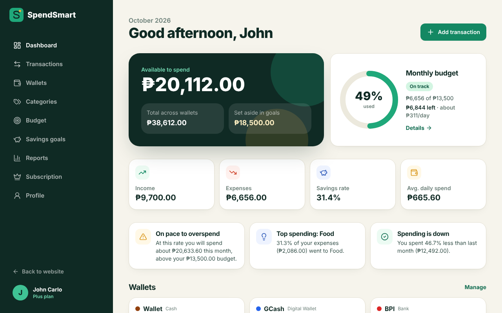

# Members
Bundalian Christian Francis E. |
Del Espiritu Kerby G. |
Perez John Carlo D. 

# Budget Tracker

A full-stack budget and expense tracker for Filipino students and young professionals. It is the web version of the BudgetTracker mobile app (Flutter), rebuilt with **React + TypeScript + Tailwind CSS**, an **Express REST API** and **MongoDB (Mongoose)**.

**Course:** CTADWEBL – Advanced Web Programming (Final Project)
**Group members:** _add names and GitHub usernames here_
**Concept:** Personal finance tracker with wallets, a monthly budget that computes your daily pace, and savings goals with deposit rules.



## What the app does and what data it processes

It does more than store records. The server computes the following:

| Area | What is computed |
|---|---|
| Wallets | Running balance per wallet = starting balance + income − expenses. An expense that would overdraw a wallet is rejected. |
| Budget | Percent used, remaining, **safe daily spend** (remaining ÷ days left), **projected month-end spend**, status `safe` / `near` (≥80%) / `over` (≥100%). A month with no budget carries forward the latest earlier one. |
| Savings goals | Progress %, amount still needed, days left, **required saving per month**, overdue flag. Deposits are limited to the free balance and the amount still needed. Withdrawals are limited to what is saved. |
| Reports | Monthly summary (net, savings rate, average and daily spend, largest and smallest expense), category breakdown with ranks and percentages, 6-month trend with month-over-month change, rule-based insights. |
| Transactions | Multi-criteria search, filter (type, month, wallet, category, amount range, text), sort and pagination, with totals for the filtered set. |
| Subscription | Plan wallet limits (Basic 1, Plus 3, Premium unlimited), 7-day trial dates, renewal date, yearly savings, and downgrade blocking if you own too many wallets. |

Dates are handled in the Philippines timezone (UTC+8) so a transaction at 1 AM on the 1st lands in the right month.

## Tech stack

React 18 (Vite) · TypeScript · Tailwind CSS · React Router · React Hook Form + Zod · axios · Recharts · Node.js · Express · MongoDB Atlas / Mongoose.


## Project structure

```
server/
  app.js            configuration and route mounting only
  server.js         connects to MongoDB and starts listening
  config/           database connection
  models/           Profile, Wallet, Category, Transaction, Budget, SavingsGoal, SavingsEntry
  routes/           one express.Router() per resource
  controllers/      request handlers
  services/         business rules (finance.js is pure and unit-tested)
  middleware/       logger, validateObjectId, notFound, errorHandler
  seed/seed.js      sample data
  tests/            unit tests and an API smoke test
client/
  src/api/          typed endpoint functions (all use lib/api.ts)
  src/schemas/      Zod schemas
  src/hooks/        custom hooks
  src/components/   UI kit, layout, forms
  src/pages/        routed pages
```

### Environment variables

| File | Variable | Purpose |
|---|---|---|
| `server/.env` | `PORT` | API port (default 5000) |
| `server/.env` | `MONGO_URI` | MongoDB connection string |
| `server/.env` | `CLIENT_URL` | Allowed frontend origin(s) for CORS, comma separated |
| `server/.env` | `TZ_OFFSET_MINUTES` | Timezone offset used for month boundaries (480 for the Philippines) |
| `client/.env` | `VITE_API_URL` | Base URL of the API |

`.env` is ignored by Git. `.env.example` files are committed.


## Error format and status codes

Every error is JSON: `{ "message": "Record not found" }`. Validation errors add `errors`: `{ "message": "Validation failed", "errors": { "amount": "Amount must be greater than zero" } }`.

| Code | When |
|---|---|
| 200 / 201 | Success / created |
| 400 | Validation error, invalid id, malformed JSON, broken business rule (overdraft, over-deposit) |
| 403 | Plan wallet limit reached, editing or deleting a default item |
| 404 | Record or route not found |
| 409 | Duplicate name, or deleting something still in use |
| 500 | Unexpected server error |


### Transactions

| Method | Path | Purpose |
|---|---|---|
| GET | `/transactions` | Search, filter, sort, paginate. Query: `q, type, month, from, to, wallet, category, paymentMethod, minAmount, maxAmount, sort (date\|amount), order, page, limit`. |
| GET | `/transactions/:id` | One transaction |
| POST | `/transactions` | Create. Rejects overdrafts and category/type mismatch. |
| PUT | `/transactions/:id` | Update (balances re-checked) |
| DELETE | `/transactions/:id` | Delete (blocked if it would overdraw a wallet) |

```json
// POST /transactions
{ "type": "Expense", "amount": 85.5, "category": "<categoryId>", "wallet": "<walletId>", "paymentMethod": "GCash", "note": "Milk tea", "date": "2026-10-10T04:00:00.000Z" }
// 201
{ "_id": "…", "type": "Expense", "amount": 85.5, "category": { "name": "Food", "icon": "utensils", "color": "#f97316" }, "wallet": { "name": "GCash" }, "note": "Milk tea" }
// 400 (amount missing)
{ "message": "Validation failed", "errors": { "amount": "Amount is required" } }
// 400 (overdraft)
{ "message": "Insufficient balance in \"GCash\" (₱970.00 available)" }
```

### Wallets

| Method | Path | Purpose |
|---|---|---|
| GET | `/wallets` | All wallets with computed `income`, `expenses`, `balance`, plus `totalBalance`, plan and `canAddMore` |
| GET | `/wallets/:id` | One wallet with stats |
| POST | `/wallets` | Create. **403** when the plan limit is reached. |
| PUT | `/wallets/:id` | Update |
| DELETE | `/wallets/:id` | Delete. 403 for the default wallet, 409 if it has transactions. |

```json
// POST /wallets   { "name": "Maya", "type": "Digital Wallet", "initialBalance": 250 }
// 403 on Plus with 3 wallets
{ "message": "Your Plus plan allows up to 3 wallets. Upgrade to add more." }
```

### Categories

| Method | Path | Purpose |
|---|---|---|
| GET | `/categories?type=Expense` | List with `transactionCount` |
| GET | `/categories/:id` | One category |
| POST | `/categories` | Create (`name, type, icon, color`). 409 on duplicate name for the same type. |
| PUT | `/categories/:id` | Update. 403 for default categories. |
| DELETE | `/categories/:id` | Delete. 403 for defaults, 409 if used. |

### Budgets

| Method | Path | Purpose |
|---|---|---|
| GET | `/budgets` | All monthly budgets |
| GET | `/budgets/status?month=2026-10` | **Computed:** spent, remaining, percentUsed, status, daysLeft, safeDailySpend, projectedSpend, willExceed |
| PUT | `/budgets/:month` | Create (201) or replace (200) the limit. Body: `{ "monthlyLimit": 13500 }` |
| DELETE | `/budgets/:month` | Remove (404 if none) |

```json
// GET /budgets/status
{ "month": "2026-10", "limit": 13500, "spent": 6656, "remaining": 6844, "percentUsed": 49.3, "status": "safe", "daysLeft": 22, "safeDailySpend": 311.09, "projectedSpend": 20633.6, "willExceed": true }
```

### Savings goals

| Method | Path | Purpose |
|---|---|---|
| GET | `/savings-goals` | Goals with `progress` and overall totals incl. `availableToSave` |
| GET | `/savings-goals/:id` | Goal with deposit/withdrawal history |
| POST | `/savings-goals` | Create (`title, targetAmount, targetDate?, color`) |
| PUT | `/savings-goals/:id` | Update (target cannot go below saved amount) |
| DELETE | `/savings-goals/:id` | Delete goal and history |
| POST | `/savings-goals/:id/deposit` | **Rule-based:** amount ≤ free balance and ≤ amount still needed |
| POST | `/savings-goals/:id/withdraw` | **Rule-based:** amount ≤ saved amount |

```json
// POST /savings-goals/:id/deposit   { "amount": 1000, "note": "Allowance" }
// 201
{ "goal": { "savedAmount": 10000, "progress": { "percent": 22.2, "remaining": 35000, "requiredPerMonth": 4375, "status": "active" } }, "availableToSave": 19112 }
// 400
{ "message": "You only need ₱35,000.00 more to reach this goal" }
```

### Reports and dashboard

| Method | Path | Purpose |
|---|---|---|
| GET | `/dashboard` | Balances, month summary, budget status, wallets, recent transactions, goals, insights in one call |
| GET | `/reports/summary?month=&wallet=` | Income, expenses, net, savingsRate, averages, largest/smallest expense |
| GET | `/reports/category-breakdown?month=&type=&wallet=` | Per-category total, count, average, percentage, rank |
| GET | `/reports/monthly-trend?months=6&wallet=` | Income, expenses, net and expense change % per month |
| GET | `/reports/insights?month=` | Plain-language advice from the numbers |

```json
// GET /reports/category-breakdown
{ "month": "2026-10", "type": "Expense", "total": 6656, "data": [ { "rank": 1, "category": { "name": "Food" }, "total": 2086, "count": 14, "average": 149, "percentage": 31.3 } ] }
```

### Profile and subscription

| Method | Path | Purpose |
|---|---|---|
| GET | `/profile` | Profile with subscription info (wallet limit, trial days left, renewal date) |
| PUT | `/profile` | Update name and email |
| GET | `/profile/plans` | Plan catalogue with prices and yearly savings |
| POST | `/profile/subscribe` | Change plan. First paid plan starts a 7-day trial. 400 if already on it, or if you own more wallets than the new plan allows. |

### Other

| Method | Path | Purpose |
|---|---|---|
| GET | `/health` | Health check |

## Known limitations

- Single user: there is no login, so all data belongs to one profile (authentication was not required).
- Subscription changes are simulated; no payments are taken.
- The month projection is linear (spent so far ÷ days elapsed × days in month), so fixed bills early in the month can make it look high.
- Transfers between wallets are not implemented; record them as an expense and an income.
"# budgettracker" 
"# budgettracker" 
"# budgettracker" 
